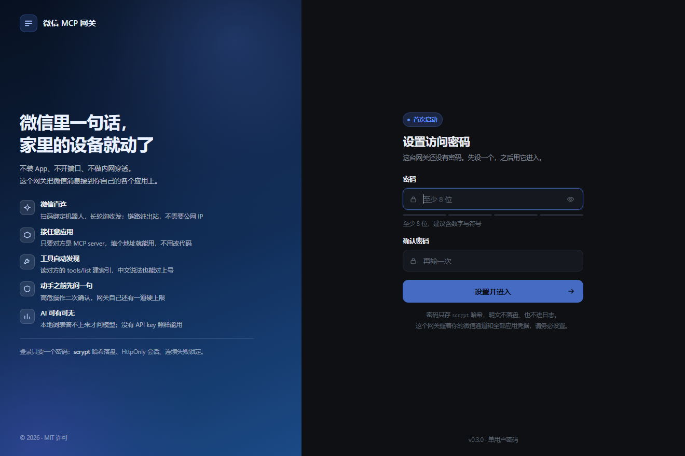
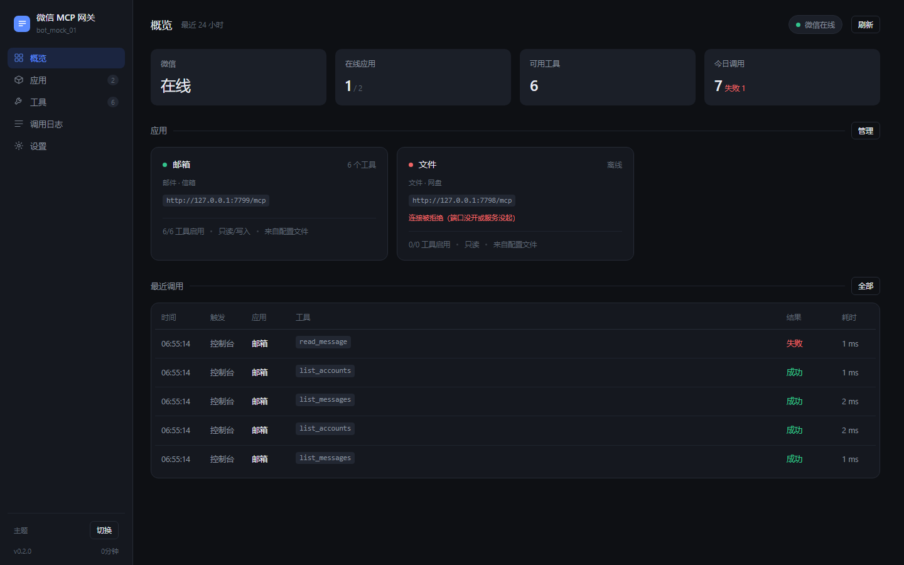
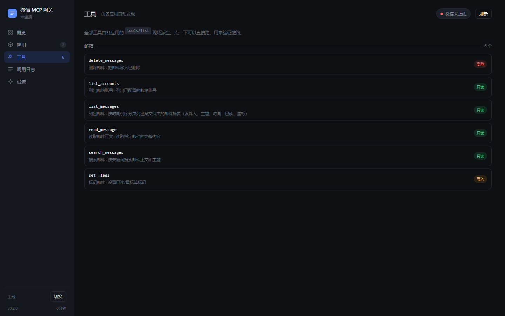
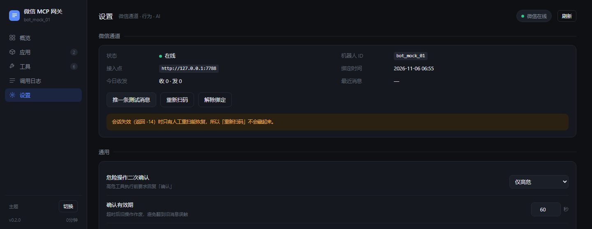

# 微信 MCP 网关

[](https://github.com/aaron2024S/wx-mcp-gateway/actions/workflows/docker.yml)

用微信控制任何 MCP server。不用公网 IP、不用端口映射、不用内网穿透。

```
手机微信  ⇄  iLink 网关（腾讯）  ⇄  本容器  ⇄  各应用的 MCP 端点
              ↑ 容器主动出站长轮询，没有任何入站连接
```

零第三方依赖，一个 Node 进程，一个数据目录。

---

## 它解决什么

单个 MCP server 很好写，但它只能被 MCP 客户端调用——而大多数 MCP 客户端是"你问它答"的，不会自己盯着消息。

这个网关补的就是那段：

| 能力 | 谁提供 |
|---|---|
| 收发微信消息 | iLink 长轮询（本文网关） |
| **一直转的循环**：有新消息 → 决定 → 执行 → 回复 | 本文网关 |
| 决定调用哪个工具 | 本地别名索引，可选 AI 兜底 |
| 工具本身 | 各应用的 `tools/list`，网关自动发现 |

所以加一个应用 = 在配置里加一段地址。**不用改代码，不用重发镜像。**

---

## 界面

第一次打开是设置密码，之后是登录：



进去以后是零构建的单页控制台，五个页面：概览、应用、工具、调用日志、设置。





微信绑定、应用管理、AI provider 都在设置页：



---

## 快速开始

**方式一：拉现成镜像**（不用 clone，NAS 面板里填也一样）

```bash
mkdir -p /volume1/docker/wx-mcp-gateway/data
cd /volume1/docker/wx-mcp-gateway

docker run -d --name wx-mcp-gateway \
  -p 7337:7337 \
  -e PORT=7337 \
  -v "$PWD/data:/data" \
  -e TZ=Asia/Shanghai \
  --restart unless-stopped \
  aaron2024s/wx-mcp-gateway:latest
```

镜像同时提供 `linux/amd64` 与 `linux/arm64`，Intel 的 NAS 和 ARM 的群晖都能直接拉。

**方式二：从源码构建**

```bash
git clone https://github.com/aaron2024S/wx-mcp-gateway.git
cd wx-mcp-gateway
mkdir -p data
cp config.example.json data/config.json
# 改 data/config.json 里的 apps[].url 和 allow_risk

docker compose up -d --build
```

### 换端口

默认 `7337`。`-p` 的左右两边、`PORT` 环境变量三处是同一个值，改的时候要一起改：

```yaml
ports:
  - "8123:8123"      # 左边是宿主机端口，可以任意；右边必须等于 PORT
environment:
  - PORT=8123        # 容器内监听端口
```

嫌改两处麻烦，就在 compose 同目录建个 `.env` 写 `PORT=8123`，然后把 compose 里那两行换成
`"${PORT:-7337}:${PORT:-7337}"` 和 `- PORT=${PORT:-7337}`，以后只改 `.env`。

### 第一次打开

打开 `http://<NAS的IP>:7337`，会先让你**设置一个访问密码**（至少 8 位，不能纯数字）。
设完自动进入，之后每次打开用它登录。

为什么强制设：这个进程手里是 `data/` 的全部内容——微信 `bot_token`、各应用访问令牌、AI 的 API key。
不设密码等于把"用你的微信驱动你的 NAS"交给同网段的任何人。

> 忘了密码只能重置：删掉 `data/auth.json` 重启容器，会回到设置密码那一步。
> 网关不存明文、也不联网，所以没有"找回"这条路。

进去之后：

1. **设置 → 微信通道 → 生成二维码**，用手机微信扫
2. 扫完在微信里给那个新出现的机器人发一句：`/status`
3. 回话就说明整条链路通了

> **注意**：刚绑定时网关不知道"推给谁"（它只从收到的消息里学），所以别急着点"推一条测试消息"。先在微信里发一句话。

不用 Docker 也行：

```bash
GATEWAY_CONFIG=./data/config.json GATEWAY_DATA=./data node src/server.js
```

Node ≥ 20。

---

## 配置

`config.json` 是**手写**的那一份，界面永不回写它（避免把 `${ENV}` 替换后的明文密钥写进磁盘）。界面上的改动落在 `data/overrides.json`，密钥落在 `data/secrets.json`。

```json
{
  "gateway": {
    "confirm_risk": ["high"],   // 这些等级必须回「确认」
    "confirm_ttl": 60,          // 确认窗口（秒），过期作废
    "call_timeout": 20,         // 单次工具调用超时
    "async_after": 10,          // 超过这么久先回「还在跑」
    "default_app": null         // 多个应用有同名工具时优先给谁
  },
  "routing": {
    "local_threshold": 0.5,     // 本地匹配到这个分数直接执行
    "ask_threshold": 0.25,      // 低于这个当"没听懂"
    "llm_when": "miss"          // never | miss | ambiguous | always
  },
  "llm": {
    "enabled": false,
    "default": "deepseek",
    "providers": {
      "deepseek": {
        "type": "openai",
        "base_url": "https://api.deepseek.com/v1",
        "model": "deepseek-chat",
        "api_key": "${DEEPSEEK_API_KEY}"
      }
    }
  },
  "apps": [
    {
      "id": "mail",
      "label": "邮箱",
      "aliases": ["邮件", "信箱"],
      "transport": "mcp-http",
      "url": "http://mailnest:8006/mcp",
      "auth": { "token": "${MAILNEST_TOKEN}" },
      "allow_risk": ["read"],
      "tools": {
        "aliases": { "list_messages": ["未读"] },
        "risk_overrides": { "delete_messages": "high" },
        "include": [],
        "exclude": []
      }
    }
  ]
}
```

### 几个不直观但要紧的字段

**`allow_risk`** —— 网关的硬上限。应用自己声明的风险等级**不能突破它**。只写 `["read"]` 就永远只能读，哪怕应用说某个工具是只读、另一个是高危。这是"双保险"里网关那一层。

**`aliases`** —— 用户不会说 id，会说"邮件""信箱"。这个字段比 `label` 影响大得多。

**`tools.aliases`** —— 只在自动匹配不够时补。实测大多数中文 MCP server 一条都不用写（见下）。

**`tools.include`** —— 留空 = 全放开。放太多会稀释识别准确率，建议只留日常真用的四五个。

---

## 微信里怎么用

直接说人话：

```
你：查一下未读
网关：「列出邮件」共 5 条：
      1. 合同确认 · 张三 · 今天 09:12  [未读]
      2. 十月报价单 · 李四 · 昨天  [未读]
      ...
      回复序号可对某一条继续操作。

你：1
网关：（读出第 1 封正文）
```

内置指令：

| 指令 | 作用 |
|---|---|
| `/help` | 说明 |
| `/list` | 已接入的应用和状态 |
| `/menu` | 全部操作（带风险等级） |
| `/status` | 网关状态 |
| `/cancel` | 取消当前待确认/待选择 |

**多轮是常态，不是缺陷**：微信只有文本，`send_message` 要 `to`/`subject`/`text` 三个参数，一句话说不全。所以缺参数时会逐项问——而写操作恰好应该慢一点、多确认一次。

### 绑定与解绑

两件事都在**设置 → 微信通道**里完成，不需要重启容器、不需要删数据目录。

| 按钮 | 什么时候用 | 做了什么 |
|---|---|---|
| 生成二维码 / 扫码 | 首次接入 | 扫码确认后自动上线，不用回来点任何按钮 |
| 推一条测试消息 | 验证"发得出去" | 给最后一个跟你说过话的会话发一条 |
| 重新扫码 | 换号、会话失效（`-14`） | 先解绑，再立刻生成新码 |
| **解除绑定** | 不想让微信再控制它 | 通知服务端停止推送 → 清空内存与磁盘凭据 → 回到「未绑定」 |

解绑的边界要说清楚：

- **只切断微信这条入口。** 应用连接、工具勾选、AI 配置、调用日志全部保留，重新扫码后一切照旧。
- **微信里的会话不会自己消失。** 那个机器人条目还在你的聊天列表里，需要你在微信侧手动删掉；本机解绑只是不再持有它的 token。
- **解绑后指令立即失效**（长轮询停止、凭据清空），不会出现"点了解绑但还能用"的中间态。
- 解绑是单侧动作：网关照常运行，只是不再收发微信消息，控制台其余功能不受影响。

### 工具是怎么被认出来的

不靠手写命令表。`tools/list` 返回的 `title` 和 `description` 本身就是人话，网关现场建索引：

| 信号 | 分数 | 谁维护 |
|---|---|---|
| 配置里手写的 `aliases` | 1.00 | 只在自动匹配不够时补 |
| 从 `title` 派生的动作词 | 0.82 | 自动（中文 title 多是"动词+名词"） |
| `name` + `description` 全文索引 | ≤ 0.92 | 自动 |

实测（12 个工具，配置里只手工写了 2 条别名）：

```
「查一下未读」          → list_messages    1.00  直接执行
「有哪些邮箱」          → list_accounts    0.83  直接执行
「搜一下发票」          → search_messages  0.82  直接执行
「把这封删了」          → delete_messages  0.82  直接执行
「今天天气怎么样」      → 没听懂
```

`delete_messages` 那条**一个别名都没配**，靠的是 title「删除邮件」前两字。

---

## AI 是可选的

**不接 AI 也能完整使用。** 本地别名表覆盖九成日常说法，零延迟、零成本、断网也能用。

接了之后，AI 只做一件事：把"本地没听懂的那句话"翻译成 `{tool, args}`。它的输出要过 `registry.find()` 校验，编出来的工具名直接丢掉。**风险判断、二次确认、审计全在执行层，AI 碰不到。**

所以最坏情况是"选错工具"，不可能是"乱执行"。

`llm_when` 四档控制什么时候调它：`never` / `miss`（默认，本地没命中才问）/ `ambiguous` / `always`。本地能确定时**一次外部请求都不发**。

支持任何兼容 `/chat/completions` 的服务（DeepSeek、通义、Kimi、智谱、Groq、Ollama、vLLM、LM Studio），Claude 单走 `/v1/messages`。**新增一家通常只加一段配置。**

---

## 安全模型

| 层 | 做法 |
|---|---|
| 风险等级 | 应用声明的 `annotations` 只作默认值，`allow_risk` 是硬上限 |
| 二次确认 | 高危操作必须回「确认」，窗口 TTL 到点作废 |
| 凭据 | `data/secrets.json`（0600），API 永不回传原值，界面只显示"已设置" |
| 控制台 | 首启强制设置访问密码，`scrypt` 哈希落盘，HttpOnly 会话，连错 5 次锁定 5 分钟 |
| 容器 | 非 root 运行 |

三条要自己守的：

1. **`data/` 目录就是全部机密**（微信 token、应用令牌、AI key）。备份它等于备份全部权限，别扔进公开网盘。
2. **不要把这个端口暴露到公网。** 虽然有一道密码，但它是给局域网用的单用户面板，没有账号体系、没有二级验证、也没有审计日志导出。
3. **微信只能是第二遥控器。** 这条通道是逆向实现，协议随时可能变。关键链路（定时同步、白名单自愈）必须还在 Web 控制台独立跑。

---

## 加一个应用

1. 确认那个应用有 HTTP 的 MCP 端点：
   ```bash
   curl -i -X POST http://<容器名>:<端口>/mcp \
     -H 'Content-Type: application/json' \
     -H 'Accept: application/json, text/event-stream' \
     -d '{"jsonrpc":"2.0","id":1,"method":"initialize","params":{"protocolVersion":"2025-06-18","capabilities":{},"clientInfo":{"name":"t","version":"1"}}}'
   ```
   回 `serverInfo` 就是能用；回 `<html>` 说明那是前端页面，不是 MCP。
2. 控制台「应用 → 添加应用」走一遍向导。**先点「测试连接」**——它会告诉你协议版本、服务端名、工具数，连不上还会区分是 DNS、端口、鉴权、路径还是 Accept 头的问题。
3. 勾工具，保存。

整个流程不动代码。如果你发现要改 `.js`，那是设计坏了。

---

## 开发与测试

```bash
npm test          # 端到端：假 iLink 网关 + 假 MCP，41 项断言
npm run test:auth # 登录：起真服务走完设密码→登录→改密→锁定，49 项断言
npm run test:llm  # AI 路由层：假 OpenAI/Anthropic 端点，22 项断言
npm run demo      # 拉起真的 MailNest 跑一遍中文匹配
```

本地看界面（两个终端）：

```bash
npm run mock:mcp     # 假 MCP server，:7799
npm run mock:ilink   # 假 iLink 网关，:7788（约 18 秒后自动"扫码确认"）

GATEWAY_CONFIG=./config.example.json GATEWAY_DATA=./.tmp-run \
  ILINK_BASE=http://127.0.0.1:7788 node src/server.js
```

测试里为什么要有假网关：iLink 的字段名和请求头无法从公开文档核对，写错一个字母的表现是"消息不进来"，在真机上要等绑完才会发现。假网关把字段固定住，改坏了立刻红。

### 代码结构

```
src/
  server.js     常驻服务：HTTP 控制台 API + 微信循环 + 应用定时刷新
  auth.js       访问密码：scrypt 哈希、会话 Cookie、失败锁定
  ilink.js      微信 iLink 协议：扫码、长轮询、发消息、-14 失效
  mcp.js        MCP 客户端：Streamable HTTP + JSON-RPC，7 类错误分类
  registry.js   工具索引：从 tools/list 现场派生，中文匹配用 idf 加权
  router.js     识别编排：本地 → AI → 菜单
  agent.js      会话编排：指令 / 待决状态 / 补参 / 风险 / 执行
  exec.js       执行层：风险闸门、参数收集、结果渲染成人话
  session.js    会话状态：确认、候选、补参、序号引用
  appstore.js   配置合并：手写配置 / 界面改动 / 密钥 三层分离
  llm.js        多 provider AI 路由
  web/          单页控制台 + 登录页，零构建
vendor/
  qrcode.cjs    QR 编码（MIT, kazuhikoarase）
```

---

## 已知限制

**iLink 不是公开接口。** 它是腾讯随 OpenClaw 放出的那条通道，社区逆向 + 官方实现并存。`bot_type=3` 随时可能改、可能限流。旁证：连 `iLink-App-ClientVersion` 这种常量，不同实现给的都不是一个值。

**一个微信号只能绑一个机器人。** 想在多个应用里各扫一次，结果不是"一个机器人管所有"，而是通讯录里多出几个联系人、各自要重扫。所以要么只接这一个网关（推荐），要么接受多个入口。

**`-14` 之后必须人工重扫。** 机器替不了。所以控制台上的「重新扫码」不会藏起来。

**微信是纯文本管道。** 图片、语音、文件会被降级成 `[图片]` 这类占位符。要传大文件的场景不适合。

**没有用户体系。** 它假设"这个机器人只有一个人用"。想给家人用，得各自扫码绑各自的机器人。

**首次设密码有一个窗口期。** 从容器起来到你设完密码之间，任何能访问到这个端口的人都可以抢先设一个。
彻底堵住要么让首启只允许本机访问、要么在日志里打一次性口令，两种做法都会把"打开就能用"这个体验做坏。
现在的缓解是限流 + 记录：设置密码时会写一条带来源 IP 的日志，事后能看出是谁设的。所以装完先把密码设了。

---

## 协议参考

| 动作 | 接口 |
|---|---|
| 取登录二维码 | `POST /ilink/bot/get_bot_qrcode?bot_type=3` |
| 轮询扫码状态 | `POST /ilink/bot/get_qrcode_status?bot_type=3&qrcode=…` |
| 上线 / 下线 | `POST /ilink/bot/msg/notifystart` / `notifystop` |
| 收消息 | `POST /ilink/bot/getupdates`（服务端扣约 35 秒，游标增量返回） |
| 发消息 | `POST /ilink/bot/sendmessage`（必须回带 `context_token`） |

请求头固定带 `AuthorizationType: ilink_bot_token`、`iLink-App-Id`、`iLink-App-ClientVersion`、`X-WECHAT-UIN`；body 里塞 `base_info{channel_version}`。扫码确认返回 `bot_token` / `ilink_bot_id` / `baseurl`，之后所有请求打 `baseurl`。

**绑定这件事的全部内容，就是扫码换一个 `bot_token`；"在线"就是循环不停地挂着一条 getupdates。** 没有注册回调地址、没有白名单 IP、没有反向隧道。

---

## 许可证

MIT，见 [LICENSE](LICENSE)。

`vendor/qrcode.cjs` 来自 [kazuhikoarase/qrcode-generator](https://github.com/kazuhikoarase/qrcode-generator)，同为 MIT。
